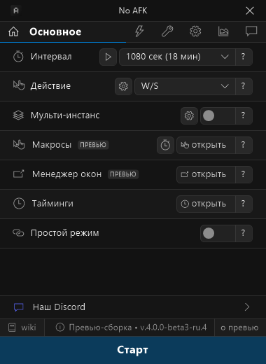

# No AFK for Roblox

**Анти-AFK для Roblox: игра больше не кикает вас за бездействие**
(«You were disconnected for being idle 20 minutes», ошибка 278).

Работает в фоне, пока вы заняты другим. Бесплатно, без рекламы, с открытым кодом.

[⬇️ Скачать последнюю версию](https://github.com/x0doit/No-AFK-for-Roblox/releases/latest) · [💬 Discord](https://discord.gg/ayame)

## Возможности

- **Анти-AFK.** Раз в заданный интервал программа на мгновение переключается на Roblox, нажимает клавишу и возвращает вас в ваше окно. Действие на выбор: W/S, прыжок, зум, случайное или ваш макрос.
- **User-Safe.** Ждёт паузы в вашей активности, чтобы не мешать, но никогда не опаздывает к 20-минутному пределу Roblox.
- **«Я могу забыть».** Сам включает анти-AFK, если вы отошли и забыли его запустить.
- **Несколько окон Roblox.** Мульти-инстанс, менеджер окон, раскладка окон сеткой.
- **Макросы и автопереподключение.** Запись своих макросов, автоматическое переподключение после кика.
- **Ресурсы.** Ограничитель FPS, очистка памяти, автоотключение звука.
- **Уведомления.** Строка состояния поверх игры, работа из трея, сообщения в Discord через вебхук.
- **Русский и английский интерфейс**, переключение на лету.
- **Обновления** приходят из этого репозитория.

## Установка

1. Скачайте `NoAFK…exe` из [последнего релиза](https://github.com/x0doit/No-AFK-for-Roblox/releases/latest) и запустите.
2. Если Windows SmartScreen покажет предупреждение, нажмите «Подробнее» → «Выполнить в любом случае».
3. Если программа не запускается, установите [Microsoft Visual C++ Redistributable x64](https://aka.ms/vc14/vc_redist.x64.exe).

Нужна Windows 10 или 11, 64-бит.

## История

Раньше этим проектом занимался Agzes, программа называлась AntiAFK-RBX. Наши взгляды на развитие программы разошлись, и так появился No AFK for Roblox.

## Лицензия

MIT. © 2024–2026 Agzes (оригинальный AntiAFK-RBX), © 2026 x0doit (No AFK for Roblox). Полный текст в файле [LICENSE](LICENSE).

---

## English

**No AFK for Roblox** is a free, open-source anti-AFK tool for Roblox on Windows. It keeps Roblox from kicking you for being idle for 20 minutes (error 278) while you do something else.

It briefly switches to Roblox at a set interval, presses a key (W/S, jump, zoom, random or your own macro) and switches back. User-Safe mode waits for a pause in your activity without ever missing Roblox's 20-minute limit. It also supports multiple Roblox windows, macros, auto-reconnect, an FPS limiter, a RAM cleaner, Discord webhook notifications and an English or Russian interface.

[Download the latest release](https://github.com/x0doit/No-AFK-for-Roblox/releases/latest) · [Discord](https://discord.gg/ayame)

Based on AntiAFK-RBX by Agzes, MIT License.
